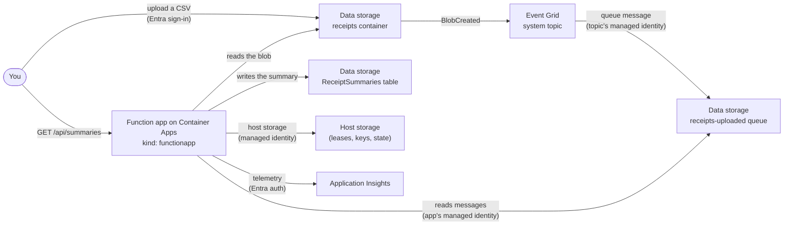

<div align="center">

# Azure Functions on Container Apps

**Event-driven .NET functions on Azure Container Apps (native kind=functionapp), passwordless and scaling to zero, deployed with azd and Terraform.**

[](LICENSE)
[](infra)
[](azure.yaml)
[](src)

[**Why**](#why-this-sample) · [**How it works**](#how-it-works) · [**Quick start**](#quick-start) · [**Cost**](#cost) · [**Documentation**](#documentation)

</div>


> **Status (2026-11-23): deployed and verified end to end.** An upload is summarized about 12 seconds later when a replica runs, and within about 80 seconds from zero replicas, through Event Grid, the queue and the function, with managed identities only. An idle day costs about USD 0.25. Every check is in [the verification table](docs/verification.md).

## Why this sample

Azure Functions can run on Azure Container Apps as a container app of kind `functionapp`: the Functions programming model, on the same platform, network and scale rules as your other containers. The [official samples](https://github.com/Azure/azure-functions-on-container-apps) are written in Bicep. This sample shows the same pattern with Terraform and azd, with managed identities for every connection, and with uploads reaching the functions through Event Grid and a queue, so that no function key has to be created or shared.

## What it shows

- A function app declared as a **container app of kind `functionapp`** (`Microsoft.App/containerApps`), with Terraform and the azapi provider.
- **No keys or connection strings:** host storage, data storage and telemetry go through the app's user-assigned managed identity; both storage accounts have shared keys disabled.
- **Event Grid to a storage queue** with the topic's own managed identity: an upload becomes a queue message, which triggers a function.
- **Scale to zero:** Container Apps generates the scale rules from the triggers (HTTP and the queue).
- **One command to deploy** with azd (remote image build in Azure Container Registry), one to tear down.

The scenario: fictional receipts. A CSV file (`date,merchant,amount,currency`) uploaded to the `receipts` container is summed per currency, and the summary is stored in a table and listed over HTTP.

## How it works

> Verified on 2026-11-20 and 2026-11-23 ([V2–V6](docs/verification.md)), scaling from and to zero included.



| Function | Trigger | What it does |
|---|---|---|
| `SummarizeReceipts` | Queue `receipts-uploaded` (Event Grid `BlobCreated` events) | Reads the uploaded CSV, sums the amounts per currency, skips and counts malformed lines, writes one row to `ReceiptSummaries` |
| `ListSummaries` | HTTP `GET /api/summaries` (anonymous, read-only) | Returns the 20 newest summaries as JSON |

Who acts on each call:

| Call | Identity |
|---|---|
| Event Grid → queue | The system topic's system-assigned identity (Storage Queue Data Message Sender on the data account) |
| Function app → host storage | The app's user-assigned identity (Blob Data Owner, Queue and Table Data Contributor on the host account) |
| Function app → data storage | The same identity (Blob Data Reader, Queue and Table Data Contributor on the data account) |
| Function app → Application Insights | The same identity (Monitoring Metrics Publisher) |
| Container Apps → registry | A separate pull identity (AcrPull) |

## What runs where

| Folder | What it holds |
|---|---|
| [`infra/functions.tf`](infra/functions.tf) | The sample's own resources: both storage accounts, the container, queue and table, Event Grid, the function app |
| [`infra/modules/function-app-container-apps/`](infra/modules/function-app-container-apps) | The function app module: container app of kind `functionapp`, its identity and roles, identity-based settings, tests |
| `infra/` (other files) | The shared base: resource group, Log Analytics and Application Insights, Container Apps environment, container registry, Key Vault, azd hooks |
| `src/` | The functions (.NET 10 isolated worker), their tests and the Dockerfile |
| `samples/` | A fictional receipts CSV to upload |
| `docs/` | Decisions, verification, the overview image |

## Quick start

> Run end to end on 2026-11-20 ([V2](docs/verification.md)): about 6 minutes for `azd up`.

Prerequisites:

- An Azure subscription where you can create resources and assign roles (Owner, or Contributor and Role Based Access Control Administrator).
- [Azure CLI](https://learn.microsoft.com/cli/azure/install-azure-cli), [Azure Developer CLI](https://learn.microsoft.com/azure/developer/azure-developer-cli/install-azd) and [Terraform](https://developer.hashicorp.com/terraform/install) 1.9 or later. No local Docker: the image is built in Azure Container Registry.

The infrastructure is one Terraform root (`infra/`), one file per part, built from the modules in `infra/modules/`. azd runs the steps of `infra/hooks/<event>/` around it (state backend before, port switch after the first deployment, a clean teardown).

```bash
az login && azd auth login
azd env new functions-on-container-apps --location francecentral
azd env set RESOURCE_TAGS "key=value,key=value"   # tags your tenant's policies require, if any
azd hooks run preprovision                        # remote state backend: once before the first preview
azd provision --preview                           # read the plan
azd up                                            # provision, then build and deploy the functions
```

Later changes: `azd provision --preview`, read the plan, then `azd provision`.

## Try it

> Verified on 2026-11-20 ([V4, V5](docs/verification.md)). Uploading needs a data role on the data account for your own account, which the infrastructure does not assign; allow a minute for the role to apply.

```bash
eval "$(azd env get-values)"
az role assignment create --assignee "$(az ad signed-in-user show --query id -o tsv)" \
  --role "Storage Blob Data Contributor" \
  --scope "$(az storage account show -n "$DATA_STORAGE_ACCOUNT" --query id -o tsv)"

az storage blob upload --auth-mode login --account-name "$DATA_STORAGE_ACCOUNT" \
  --container-name "$RECEIPTS_CONTAINER" --name receipts-2026-11.csv --file samples/receipts-2026-11.csv

curl -s "$RECEIPT_FUNCTIONS_URL/api/summaries"
```

With the sample file, the answer is:

```json
[{"blobName":"receipts-2026-11.csv","lineCount":10,"malformedLineCount":0,"totals":{"EUR":94.70,"GBP":12.35,"USD":248.99},"processedAt":"…"}]
```

The first call after an idle period waits for a replica to start (scale from zero).

## Design notes

- **Native `kind: functionapp` rather than a `Microsoft.Web/sites` app on a Container Apps environment** ([D1](docs/DECISIONS.md)): the [samples repository](https://github.com/Azure/azure-functions-on-container-apps#readme) marks the native model as recommended for new workloads.
- **azapi for the function app** ([D2](docs/DECISIONS.md)): `azurerm_container_app` has no `kind` argument (checked in the azurerm 4.81 schema, 2026-11-23).
- **Event Grid to a queue rather than a blob trigger** ([D3](docs/DECISIONS.md)): no system key to create, store and rotate for an Event Grid webhook, and the queue trigger has a generated scale rule.
- **Two storage accounts** ([D4](docs/DECISIONS.md)): the Functions host's own blobs, queues and tables stay apart from the sample's data.
- **The table through Azure Resource Manager** ([D9](docs/DECISIONS.md)): `azurerm_storage_table` sets access policies with a shared key, which the data account refuses; azapi creates it through ARM.
- **Port 8080** ([D5](docs/DECISIONS.md)): the image sets it explicitly, so that the switch from the placeholder image (port 80) happens once, after the first deployment.

## Tech stack

| Technology | Role | Version (2026-11-20) |
|---|---|---|
| Azure Container Apps | Hosting (Consumption workload profile), `Microsoft.App/containerApps` API `2025-07-01` | — |
| Azure Functions | Programming model; host image `mcr.microsoft.com/azure-functions/dotnet-isolated:4-dotnet-isolated10.0` | Functions v4 |
| .NET | Function code, isolated worker | 10 |
| Azure Event Grid | Blob events to the queue | — |
| Azure Storage | Host storage; data (blob, queue, table) | — |
| Terraform | Infrastructure, azurerm and azapi providers | 1.15.8; azurerm 4.81; azapi 2.14 |
| Azure Developer CLI | Provision, build and deploy | — |

## Documentation

| Document | Content |
|---|---|
| [Decisions](docs/DECISIONS.md) | Each design choice and why |
| [Verification](docs/verification.md) | What was checked, how and when |
| [Security](SECURITY.md) | How to report a vulnerability, and how to use the sample safely |
| [AGENTS.md](AGENTS.md) | How the sample is built, for people and coding agents |

## Versions and preview notes

- The function app is declared with API version `2025-07-01` of `Microsoft.App/containerApps` (2026-11-20).
- Container Apps generates scale rules from the triggers and needs ingress enabled for them; blob triggers scale only with Event Grid as their source ([Functions on Container Apps](https://learn.microsoft.com/azure/container-apps/functions-overview), page updated 2026-09-09).
- Deployment slots, Functions proxies and generating function access keys in the portal are not available for Functions on Container Apps (same page).
- Scale-out goes up to 1,000 replicas per app, 10 by default (same page); this sample sets 10.

## Clean up

`azd down --purge` deletes the resource group and everything in it, and purges what is soft-deleted.

## Cost

Measured on 2026-11-21 and 2026-11-22 ([V7](docs/verification.md)), actual cost in francecentral, idle:

| Meter | Per idle day (USD) |
|---|---|
| Container Registry (Basic) | 0.17 |
| Log Analytics | 0.04 |
| Container Apps (0 replicas) | 0.04 |
| Storage, Event Grid, Key Vault | under 0.01 |
| **Total** | **about 0.25 (about 7.50 per month)** |

Processing a file costs a few seconds of one replica (0.5 vCPU, 1 GiB) on the Consumption workload profile. Defender for Cloud plans enabled on a subscription add their own cost.

## License

[MIT](LICENSE)
