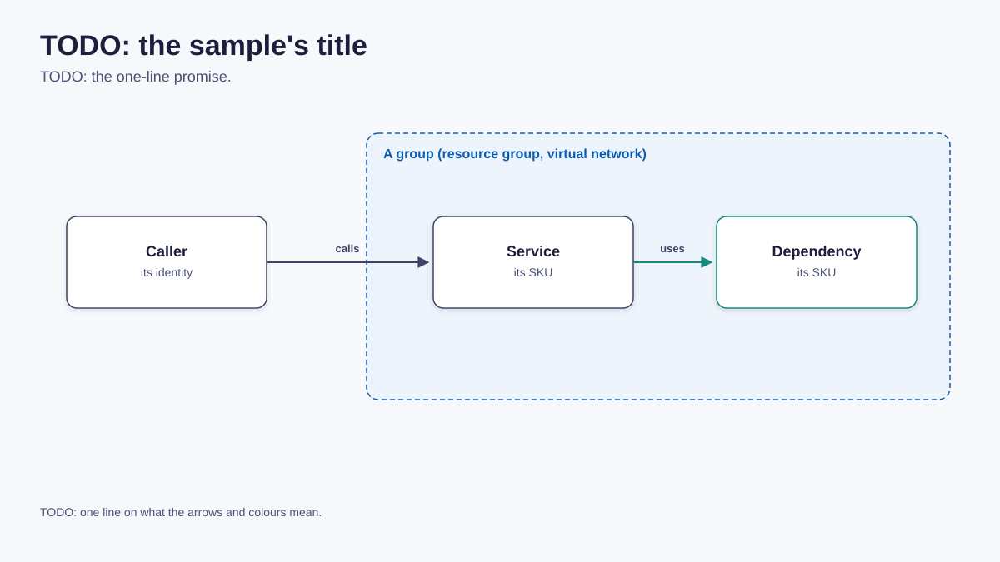
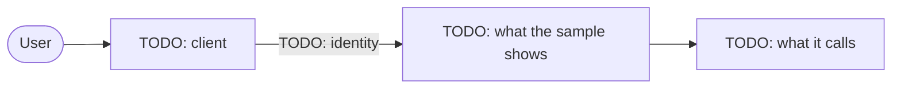

<div align="center">

# Azure Functions on Container Apps

**Event-driven .NET functions on Azure Container Apps (native kind=functionapp), passwordless and scaling to zero, deployed with azd and Terraform.**

[](LICENSE)
[](infra)
[](azure.yaml)

[**Why**](#why-this-sample) · [**How it works**](#how-it-works) · [**Quick start**](#quick-start) · [**Cost**](#cost) · [**Documentation**](#documentation)

</div>

> **Status:** in progress. The design is in [the decisions](docs/DECISIONS.md); what is checked, how and when, in [the verification table](docs/verification.md).



## Why this sample

TODO: the problem in three or four sentences, before the solution.

## What it shows

- TODO: one bullet per pattern the sample shows.

TODO: one line on the scenario (fictional company, fictional data).

## How it works

TODO: what runs where, and with which identities; one arrow per call, from the caller to what it calls.



## What runs where

| Folder | What it holds |
|---|---|
| `docs/` | Decisions, verification, the overview image |
| `src/` | TODO |
| `infra/` | The infrastructure: one Terraform root, its modules and azd hooks |

## Quick start

Prerequisites:

- TODO: roles, licences, tools with their versions.

The infrastructure is one Terraform root (`infra/`), one file per part, built from the modules in `infra/modules/`. azd runs the steps of `infra/hooks/<event>/` around it (state backend before, configuration after, a clean teardown).

```bash
az login && azd auth login
azd env new functions-on-container-apps --location francecentral
azd env set RESOURCE_TAGS "key=value,key=value"   # tags your tenant's policies require, if any
azd hooks run preprovision                        # remote state backend: once before the first preview
azd provision --preview                           # read the plan
azd up                                            # provision, then deploy the services
```

Later changes: `azd provision --preview`, read the plan, then `azd provision`.

Tear it down with `azd down --purge` (see [Clean up](#clean-up)).

## Daily use

TODO: what to do once it runs: open it, share it, observe it.

## Design notes

The decisions a reader would question, each in one paragraph, with a link to [the decisions](docs/DECISIONS.md).

## Tech stack

| Technology | Role | Version |
|---|---|---|
| TODO | TODO | TODO (dated) |

## Documentation

| Document | Content |
|---|---|
| [Decisions](docs/DECISIONS.md) | Each design choice and why |
| [Verification](docs/verification.md) | What was checked, how and when |
| [Security](SECURITY.md) | How to report a vulnerability, and how to use the sample safely |
| [AGENTS.md](AGENTS.md) | How the sample is built, for people and coding agents |

## Versions and preview notes

Dated, factual and neutral: pre-release packages, settings in preview, what depends on the tenant or the region.

- TODO

## Clean up

`azd down --purge` deletes the resource group and everything in it.

## Cost

TODO: measured, per day and per month, with the date (Cost Management), and the list prices it compares with. Prices go here, not in the overview image.

## License

[MIT](LICENSE)
